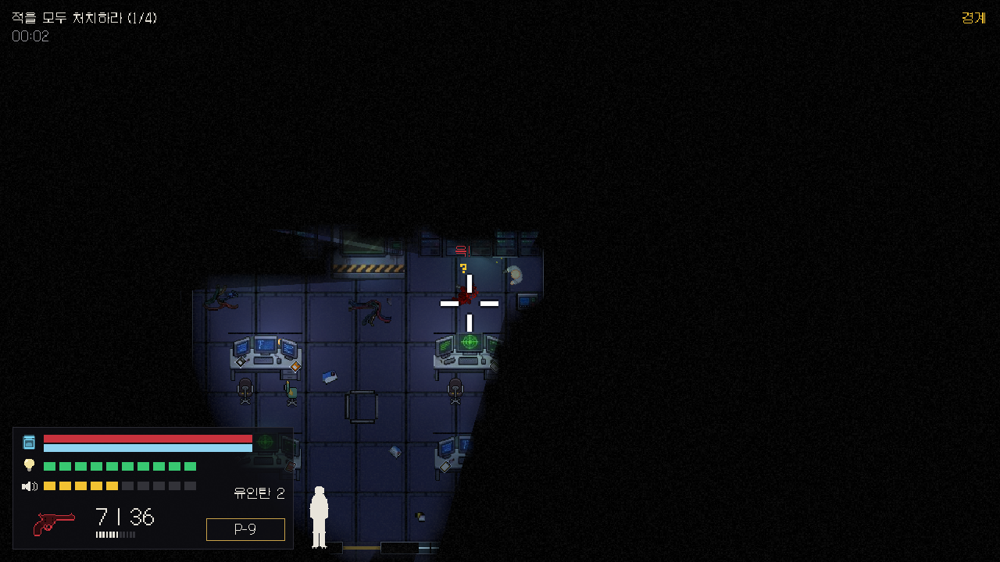
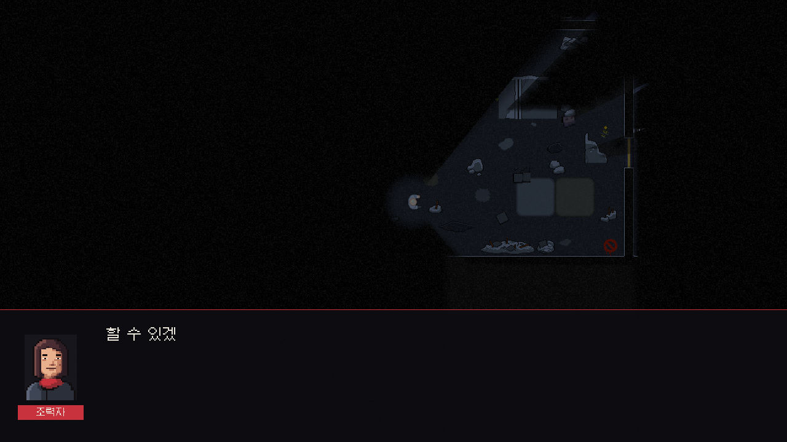
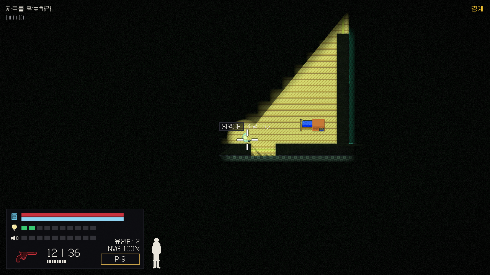

# NULL TRACE — 2D 탑뷰 전술 잠입 슈팅 (Unity 6)

플레이어 혼자 침투해 목표를 수행하고 탈출하는 2D 탑뷰 잠입·슈팅 게임입니다.
소리·시야·**빛과 어둠**·문·엄폐를 이용해 적에게 들키지 않고 처리하거나, 들키면 교전합니다.
적은 보고 들은 것(소리·단서·시야 이벤트 22종)에만 반응하고, 그 순간의 상황을 로컬 Qwen이 20자 이내 대사로 말합니다.

| 실내 교전 | 브리핑 대화 | 야간 투시 |
| --- | --- | --- |
|  |  |  |

목표 화면과 나란히 비교한 이미지는 `docs/evidence/compare_0*.png`입니다.

- **엔진**: Unity 6 (6000.3.24f1), URP 2D, C#, Windows PC
- **그래픽**: 픽셀아트 정탑뷰(1m = 32px), 어두운 배경 + 따뜻한 2D 조명. 외부 에셋이 없어도 코드 생성 그림·소리로 실행
- **미션**: 맵 4종 — ① 소탕 ② 자료 탈취 ③ 자료 탈취 후 탈출 ④ 최종 소탕 (폭탄 해체는 `missions.json`의 `bomb.enabled`로 맵 3 대체)
- **AI**: 학습형 AI 없이 FSM 6상태 + 교전 행동 트리 + 직접 구현한 A*. 인지 게이지(시각)와 의심도(소리·단서·시야 이벤트 기여의 합), 긴장도 6단계, 동료 경보·무전, 수색, 엄폐 이동, 문 기대 상태, 시체·동료 사망 반응
- **상황 대사**: 같은 PC의 Ollama(`qwen2.5:7b`)에 비동기 요청 → 20자·한국어·정보 누출·금지어·반복·상황 일치 검증 → 실패·지연·서버 없음이면 기본 대사. 대사는 AI 판단에 영향이 없다

## 조작

| 동작 | 입력 |
| --- | --- |
| 이동 / 조준 / 사격 | WASD / 마우스 / 좌클릭 (소총은 누르고 있으면 연사) |
| 달리기 / 웅크리기 | Left Shift / Left Ctrl (누르고 있는 동안) |
| 재장전 / 무기 | R / 1 권총 · 2 소음권총 · 3 소총 |
| 상호작용(문·자료·폭탄·조명 스위치) | **Space** (폭탄은 누르고 있기) |
| 근접 제압 / 유인탄 / 야간 투시 | F / G / N |
| 대화 넘기기 / 선택지 | Space·좌클릭 / 1~3 |
| 일시정지 / 디버그 | Esc / F3 (디버그 중 적을 오른쪽 클릭하면 마지막 Qwen 입력·출력) |

## 실행

1. Unity 6000.3.24f1로 프로젝트를 연다.
2. 메뉴 `Tools/Build Project`를 실행한다(URP 2D 설정, 에셋 카탈로그, 씬, 빌드 설정 생성).
3. `Assets/_Project/Scenes/MainMenu.unity`를 열고 Play → 시작 → 미션·난이도 선택.

Windows 빌드는 `Tools/Build Windows Player`, 결과는 `Build/Game.exe`.

### 상황 대사(Qwen) 켜기 — 선택

```powershell
ollama pull qwen2.5:7b        # 한 번만
ollama run qwen2.5:7b "안녕"  # 예열(첫 호출은 모델을 불러오느라 수십 초)
```

설정은 `Assets/StreamingAssets/Config/qwen.json`(주소는 `127.0.0.1`만 허용). 서버가 없으면 경고 한 번 뒤 기본 대사로 그대로 동작한다. `llama-server`를 쓰려면 `endpoint`만 `http://127.0.0.1:8080/v1/chat/completions`로 바꾼다. 에디터 메뉴 `Tools/Pregenerate Barks`는 상황별 대사를 미리 만들어 `barks.json`에 더한다.

### 테스트·자동 확인

```powershell
$U = "C:\Program Files\Unity\Hub\Editor\6000.3.24f1\Editor\Unity.exe"
& $U -batchmode -projectPath . -runTests -testPlatform EditMode -testResults Logs/editmode.xml   # EditMode 257개
.\Build\Game.exe -smoke Logs\smoke -scenario ai      # 빌드를 정해진 조작으로 실행해 보고서·스크린샷 저장
```

시나리오: `ai`(순찰·조사·교전·수색) · `mission`(소탕 성공·실패) · `ui` · `menu` · `maps`(맵 2~4) · `gadgets`(유인탄·야간 투시·스위치) · `replay`(고정 시드 3회 비교) · `perf`(적 20명 60초) · `soak -minutes 30` · `evidence`. 결과 기록은 [docs/VERIFY.md](docs/VERIFY.md).

## 문서

- [MASTER_PROMPT.md](docs/MASTER_PROMPT.md) — 개발 지시서(규칙·수치·데이터 형식·Phase)
- [요구사항 정의서.md](docs/요구사항%20정의서.md) · [기능 정의서.md](docs/기능%20정의서.md) · [DB설계.md](docs/DB설계.md)
- [ASSET_DIRECTION.md](docs/ASSET_DIRECTION.md) · [ASSET_CREDITS.md](docs/ASSET_CREDITS.md) · [DECISIONS.md](docs/DECISIONS.md) · [VERIFY.md](docs/VERIFY.md)

## 폴더 구조

```
Assets/_Project/Scripts/   Core · Grid · Player · Weapons · Combat · Vision · Map · Mission · AI(Events·Perception·FSM·Navigation·Bark) · UI · Audio · Data · Debug · Util
Assets/_Project/Editor/    ProjectBuilder(Tools/Build Project), AssetCatalogBuilder, BarkPregenerator
Assets/_Project/Art/       픽셀아트 (없으면 코드 생성 스프라이트)
Assets/_Project/Audio/     sfx · bgm (없으면 코드 생성 톤)
Assets/StreamingAssets/Config/   game · weapons · enemies · ai · difficulty · missions · barks · dialogue · events · qwen .json, maps/
Assets/Tests/EditMode/     EditMode 테스트
AssetSource/               외부 에셋 원본·라이선스, 맵 생성기(maps/gen_maps.py)
docs/evidence/             스크린샷·목표 화면 비교·상태 전이 로그·성능 기록
```

## Git 사용 규칙

1. `main`에 직접 push하지 않는다. 작업마다 브랜치를 만든다. (`feature/기능명`, `fix/내용`)
2. 작업 시작 전에 `git pull`로 최신 상태를 받는다.
3. 커밋 메시지는 `종류: 요약` 형식으로 쓴다. (`feat` 기능, `fix` 수정, `docs` 문서, `chore` 기타)
4. 작업이 끝나면 Pull Request를 올리고, 팀원 1명 이상 확인 후 `main`에 합친다.
5. **씬(`.unity`)과 프리팹(`.prefab`)은 한 사람만 수정한다.** 합치기 충돌이 나면 복구가 어렵다. 수정이 필요하면 팀원에게 먼저 알린다.
6. `.meta` 파일은 반드시 같이 커밋한다. `Library/`, `Temp/` 등은 올리지 않는다(`.gitignore`).
7. 충돌이 나면 혼자 덮어쓰지 말고 팀원과 같이 해결한다.
