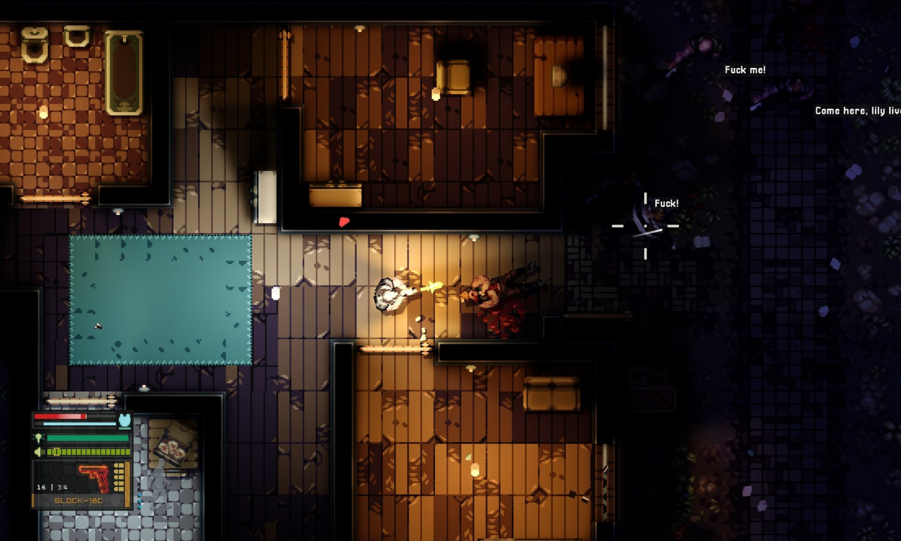
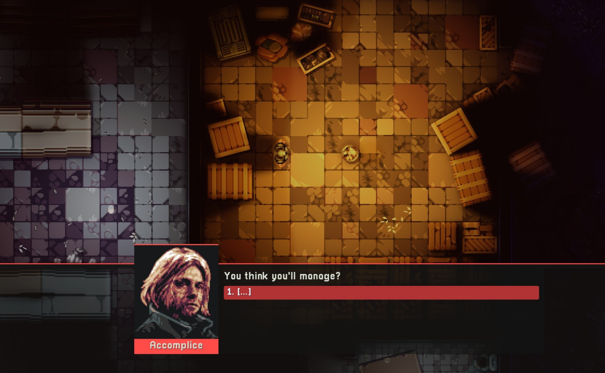
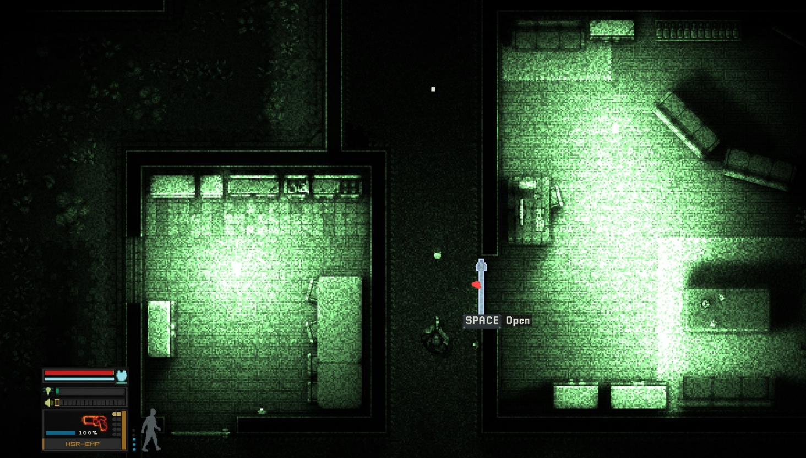

# 2D 탑뷰 전술 잠입 슈팅 (Unity 6)

플레이어 혼자 침투해 목표를 수행하고 탈출하는 2D 탑뷰 잠입·슈팅 게임입니다.
소리·시야·**빛과 어둠**·문·엄폐를 이용해 적에게 들키지 않고 처리하거나, 들키면 교전합니다.

| 실내 교전 | 브리핑 대화 | 야간 투시 |
| --- | --- | --- |
|  |  |  |

> 위 이미지는 **목표 화면(스타일 참고용)** 입니다. 실제 게임 스크린샷은 `docs/evidence/`에 추가합니다.

- **엔진**: Unity 6 (6000.3.24f1), URP 2D, C#, Windows PC
- **그래픽**: 픽셀아트 정탑뷰(1m = 32px), 어두운 배경 + 따뜻한 2D 조명
- **조작**: WASD 이동 / 마우스 조준·사격 / Shift 달리기 / Ctrl 웅크리기 / R 재장전 / 1·2·3 무기 / **Space 상호작용** / F 근접 제압 / G 유인탄 / N 야간 투시 / Esc 일시정지 / F3 디버그
- **미션**: 소탕, 자료 탈취, 자료 탈취 후 탈출 (맵 4종), 시작·종료 때 브리핑 대화
- **AI**: 학습형 AI 없이 규칙 기반 FSM + 행동 트리 + 직접 구현한 A*. 적은 보고(밝기 반영) 들은 것에만 반응
- **문서**: [docs/](docs/)
  - [MASTER_PROMPT.md](docs/MASTER_PROMPT.md) — 개발 지시서(규칙·수치·데이터 형식·Phase)
  - [요구사항 정의서.md](docs/요구사항%20정의서.md) — 확정 결정(#1~#30)과 요구사항
  - [기능 정의서.md](docs/기능%20정의서.md) — 기능 54개의 동작 규칙
  - [ASSET_DIRECTION.md](docs/ASSET_DIRECTION.md) — 목표 화면 분석, 아트·사운드 방향, 파일 이름 규칙
  - [ASSET_CREDITS.md](docs/ASSET_CREDITS.md) — 외부 에셋 출처·라이선스

## 폴더 구조

```
Assets/_Project/Scripts/   Core · Grid · Player · Weapons · Combat · Vision · Map · Mission · AI · UI · Audio · Data · Debug · Util
Assets/_Project/Art/       픽셀아트 (없으면 코드 생성 스프라이트)
Assets/_Project/Audio/     sfx · bgm (없으면 코드 생성 톤)
Assets/StreamingAssets/Config/   게임 수치·맵·대사 JSON
docs/reference/            목표 화면 3장
```

## Git 사용 규칙

1. `main`에 직접 push하지 않는다. 작업마다 브랜치를 만든다. (`feature/기능명`, `fix/내용`)
2. 작업 시작 전에 `git pull`로 최신 상태를 받는다.
3. 커밋 메시지는 `종류: 요약` 형식으로 쓴다. (`feat` 기능, `fix` 수정, `docs` 문서, `chore` 기타)
4. 작업이 끝나면 Pull Request를 올리고, 팀원 1명 이상 확인 후 `main`에 합친다.
5. **씬(`.unity`)과 프리팹(`.prefab`)은 한 사람만 수정한다.** 합치기 충돌이 나면 복구가 어렵다. 수정이 필요하면 팀원에게 먼저 알린다.
6. `.meta` 파일은 반드시 같이 커밋한다. `Library/`, `Temp/` 등은 올리지 않는다(`.gitignore`).
7. 충돌이 나면 혼자 덮어쓰지 말고 팀원과 같이 해결한다.
