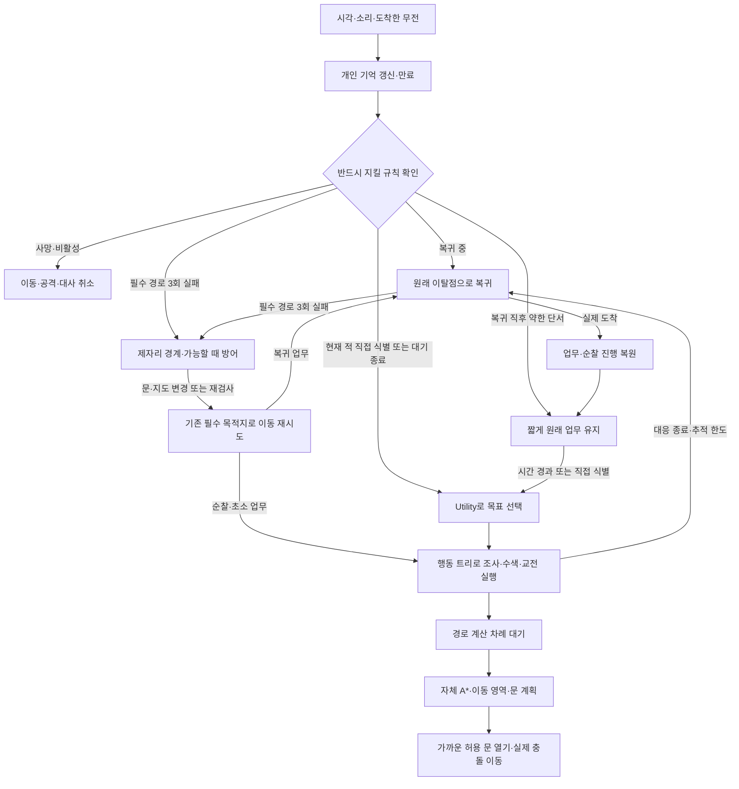

# Null Trace 적 NPC AI 인수인계 및 사양 확인

작성일: 2026-11-06 · Unity 6000.3.24f1 · URP 2D · XY 평면

**상태: 구현·시연 연결·실행 검증 완료. EditMode 180개 + PlayMode 28개 = 208개 통과, 실패·스킵 0.**

이 문서는 팀 피드백을 반영한 코드의 사용 설명서다. 11월 5일 PDF는 당시 설계 설명으로 보존한다. 재이탈 보호·문·기억·부하 제한은 이 문서의 최종 사양을 우선한다. Unity 버전과 자체 A* 구현은 바꾸지 않는다.

## 1. 이번에 달라진 행동

| 팀 의견 | 반영 방향 | 유지하는 조건 |
|---|---|---|
| 복귀 후 말없이 공격을 무시하면 어색함 | 단서를 못 찾았을 때와 적을 놓쳤을 때의 대사를 구분한다. | 대사가 끝날 때까지 AI가 기다리지 않는다. |
| 재이탈 보호가 복잡함 | 다음 순찰점/초소 도착 조건을 없애고 약한 단서에만 기본 2초 대기를 둔다. | 처리한 같은 단서로 다시 출발하지 않는다. 현재 직접 식별한 적은 대기를 우회한다. |
| 문이 잠기면 계속 멈춤 | 열 수 있는 문은 가까이에서 열고 통과한다. 잠금문은 우회하며, 길이 없으면 제자리 경계·방어한다. | 잠금 해제·벽 통과·가짜 복귀 완료는 하지 않는다. |
| 사건별 기록이 지나치게 복잡함 | 유효 단서는 최대 8개만 보관하고 간접 보고의 신뢰도 병합을 단순화한다. | 오래된 관측·중복 무전·미수신 정보로 부당하게 적을 알아내지 않는다. |
| 많은 NPC의 동시 계산이 걱정됨 | 경로 계산을 프레임마다 나누고 무전 대기·대사 생성에도 상한을 둔다. | 예산을 기다리는 것은 길찾기 실패나 업무 완료가 아니다. |

## 2. 전체 작동 흐름

복귀가 아닌 일반 순찰/초소 이동이 막힌 경우에는 그 업무로 되돌아간다. 위 그림의 경계 상태가 임의의 새 추적을 시작하거나 복귀 목적지를 바꾸지는 않는다.

Utility는 할 일을 고르고, 행동 트리는 그 일의 순서를 실행한다. 길찾기는 이동 경로를 계산하고, 대사는 이미 결정된 상황을 설명한다. 네 역할이 서로의 결정을 대신하지 않는다.

## 3. 재이탈과 복귀 사양

예를 들어 3번 순찰점을 지나 4번으로 가다 소리를 따라갔다면, 최초 이탈점과 다음 순번 4를 저장한다. 대응이 끝나면 이탈점에 실제로 돌아오고 4번으로 가던 업무를 재개한다. 새 단서가 생겨도 같은 추적의 이탈점·마감·허용 영역은 늘리지 않는다.

복귀 뒤 기본 2초 동안은 새 소리나 무전 같은 간접 단서를 곧바로 따라가지 않는다. **4번 지점이나 초소에 도착해야만 다시 대응할 수 있다는 조건은 제거했다.** 이 시간에도 감각과 기억은 갱신한다. 현재 적을 직접 식별했다면 정상적인 시야·사거리·구역 검사를 거쳐 대응한다.

‘직접 식별’은 어둠 속의 잠깐 움직임이나 무전 보고와 다르다. 거리·조도·시야각·벽 차폐·식별 누적을 통과한 실제 현재 관측이다. 무전으로 위치를 안다는 이유만으로 벽 너머 적을 쏘지 않는다.

일반적인 복귀 이동은 여전히 업무 복원을 우선한다. **경로가 완전히 막혀 대기 중인 경우에만 제자리 방어 예외**가 적용된다. 이 예외도 추적 시간을 초기화하거나 다른 방으로 쫓아가는 허가는 아니다.

위협이 계속 보이면 순찰이 늦어질 수 있다. 이번 변경에서는 억지로 순찰 지점을 하나씩 완료하게 하는 보장보다, 눈앞의 적에 자연스럽게 반응하는 행동을 택했다.

## 4. 문과 경로가 막혔을 때

| 문 상태 | 경로 계획 | 실제 행동 |
|---|---|---|
| 열린 문 | 통행 가능 | 기존 몸체·영역 검사 후 이동 |
| 닫혔지만 NPC 개방 허용 | 통과 후보로 포함 가능 | 문 가까이에서 실제로 연 후 이동 |
| 잠겼거나 NPC 개방 불가 | 통행 불가 | 허용 영역 안에서 우회로 탐색 |
| 우회로도 없음 | 완전 경로 없음 | 제한 재탐색 후 제자리 경계·보고·가능한 방어 |

첫 실패를 포함해 최소 1초 간격으로 최대 3회 검사한다. 계속 막히면 기본 5초 간격이나 지도 변경 때 다시 검사한다. 실패 보고는 반복해서 화면을 도배하지 않으며, 상세 원인은 개발용 `PathError`에 남긴다.

잠금문을 NPC가 임의로 열지는 않는다. 통로를 여는 게임 규칙이나 레벨의 우회로가 없으면 원래 업무를 재개할 수 없다. 제자리 경계는 이 상황에서 멍하니 서 있는 모습을 줄이는 대응이며, 닫힌 공간을 통과하는 해결책은 아니다. 레벨 담당자는 **필수 복귀 통로의 영구 폐쇄 여부**를 반드시 확인한다.

문 오브젝트에 `AiDoor2D`를 붙이고 `World`와 독립된 비 Trigger `DoorCollider`를 연결한다. 문 레이어는 World.ObstacleMask에 포함되어야 한다. 벽과 합쳐진 CompositeCollider를 문 하나의 Collider로 쓰지 않는다.

| 문 연결 API | 의미 |
|---|---|
| `TrySetOpen(true/false)` | 수동 열기/닫기. 성공 여부를 bool로 반환한다. 잠금문 열기와 NPC가 끼는 닫기는 거부한다. |
| `TrySetLocked(true/false)` | 잠금 시 닫힘도 함께 적용한다. 닫을 수 없으면 잠금과 열림 상태를 보존한다. 해제는 자동 개방이 아니다. |
| `SetNpcCanOpen(bool)` | 잠기지 않은 문을 NPC가 열어도 되는지 설정한다. 수동 개폐 권한과 구분한다. |
| `IsOpen`, `IsLocked`, `NpcCanOpen` | 현재 상태 조회. Collider.enabled를 직접 바꾸지 말고 위 상태 API를 사용한다. |
| `StateChanged` | 물리 상태와 격자 Revision을 갱신한 뒤 알린다. 문 소리·외형 표시를 연결한다. |

현재 문 개방은 Collider를 즉시 끄는 방식이다. 애니메이션 재생 완료를 기다리는 방식은 아직 연결하지 않았다. 실제 문 애니메이션을 넣을 때 물리 개방 시점도 함께 맞춰야 한다. 가까운 문 열기는 현재 이동 방향 앞 최대 0.5 월드 단위의 짧은 구간에만 적용하며, 벽 뒤 문을 원격으로 열지 않는다.

닫기 안전 검사는 활성 GameObject의 EnemyAgent 몸체를 대상으로 한다. **팀 플레이어·다른 물건의 끼임 방지**는 해당 몸체를 연결한 뒤 보완해야 한다. NPC가 끼면 닫기/잠금 요청이 false로 돌아오므로 게임 UI도 성공했다고 표시하면 안 된다. 추가 계약은 [문 연결 상세](Navigation-Feedback-Implementation-2026-11-06.md)를 참조한다.

## 5. 개인 기억과 무전

블랙보드는 NPC가 참고하는 메모장이다. 복귀점·순찰 순번 같은 업무 기록과, 보고 들은 단서 기록은 역할이 다르다. 단서 기록을 줄여도 원래 업무로 돌아가기 위한 기록은 유지한다.

- 유효 단서는 최대 8개만 보관한다. 용량이 차면 처리된 단서나 오래된 약한 단서를 먼저 버린다.
- 현재 직접 목격을 새 발소리 몇 개가 밀어내지 않도록 우선한다.
- 같은 사건의 재전송은 새 의심 점수나 새 사건이 아니다. 기록에서 밀려난 사건도 제한된 중복 기억으로 재유입을 막는다.
- 오래된 무전은 최신 직접 관측 위치를 덮어쓰지 않는다. 수신 시각으로 원래 만료 시간을 연장하지 않는다.
- 소리를 새로 들었다고 과거 목격의 시간이 갱신되지 않는다. 현재 직접 시야와 기억 속 마지막 위치도 구분한다.
- 정보는 무전이 실제로 도착한 NPC의 기억에만 들어간다. 수신자는 보고를 자동 재방송하지 않는다.

상한을 넘는 단서는 일부 버릴 수 있다. 모든 사건의 완전한 기록을 보존하는 시스템이 아니므로, 과도한 동시 소음 상황에서는 중요하거나 최신인 정보에 집중한다. 제거한 사건 이력은 최근 32개까지 보관한다. 무전 대기 사본 상한은 채널당 기본 256개이며, 같은 수신자/사건은 이미 대기 중인 사본과 합친다. 먼저 접수한 관측과 전달 시각을 유지하고 상한을 넘는 신규 사본은 버린다. 수신 지연 0.5초를 반복 보고로 앞당기거나 계속 미루지 않는다.

## 6. 대사와 Qwen

‘착각인가?’는 확인되지 않은 단서를 조사했으나 적을 찾지 못한 상황에 쓴다. 적을 확인했다가 놓쳤다면 놓쳤다는 사실을 말하며, 현재 적이 보이는데 착각이라고 말하지 않는다. 이동 실패의 격자 좌표나 함수 이름을 NPC 대사로 노출하지 않는다.

Qwen은 선택 사항이다. 기본 문장만으로 모든 게임 행동을 실행할 수 있다. NPC당 현재 표시를 기다리는 요청은 하나, 전체 실제 미완료 생성 작업은 기본 2개로 제한한다. 자리가 없으면 기다리는 요청을 무한히 쌓지 않고 기본 문장을 사용한다. 취소 신호를 무시한 생성 작업은 실제로 종료될 때까지 실행 슬롯을 차지한다.

출력 지연·실패·빈 문장·상황 변경·일시정지를 처리한다. 생성된 문장이 공격 여부, 의심도 또는 목적지를 변경할 수는 없다. 실제 Qwen 모델과 추론 제공자는 아직 연결하지 않는다.

## 7. 많은 NPC와 계산 예산

World 오브젝트의 `PathRequestBudget.RequestsPerFrame` 기본값은 **4회**다. 먼저 기다린 NPC에게 먼저 계산 기회를 주고, 취소·비활성·파괴된 NPC가 뒤의 줄을 막지 않게 한다. 컴포넌트가 없으면 첫 경로 요청 때 자동으로 추가되며, 미리 붙이면 Inspector에서 설정할 수 있다.

`PendingCount`는 기다리는 NPC 수, `RequestsThisTick`은 마지막 신청을 처리한 프레임에 허용한 경로 요청 수다. 대기열에서 차례를 기다리는 동안 실패 횟수를 늘리지 않는다. 경로가 생긴 뒤의 실제 이동과 공격 안전 검사는 필요한 시점에 계속 수행한다.

**4회는 시간(ms)이나 최대 NPC 수의 보장이 아니다.** 복잡한 맵의 A* 한 번이 작은 맵보다 오래 걸릴 수 있다. 프레임 예산을 낮추면 계산이 분산되는 대신 반응이 늦어질 수 있다. 동시 생성·무전·문 변경·렌더링 비용도 함께 확인해야 한다.

정상 게임은 자동 `Update`만 사용한다. 수동 검사에서는 같은 월드의 모든 NPC를 같은 시간 간격으로 진행한다. 자동과 수동 Tick을 섞지 않는다. 수동 예산의 프레임 기준은 `floor(GameTime × 60)`이다.

| 설정·규칙 | 기본값 | 팀에서 조절할 때의 의미 |
|---|---|---|
| `EnemyProfile.RecoveryDuration` | 2초 | 복귀 뒤 약한 단서를 따라가기 전 대기. 직접 식별 대응을 막지 않는다. |
| `EnemyProfile.PathRetryDelay` | 1초 | 초기 실패 재시도 간격. 최소 1초를 지킨다. |
| 필수 경로 실패 한도·이후 재검사 | 3회·5초 | 제자리 경계로 전환한다. 지도 변경도 마지막 시도에서 최소 1초 뒤 검사한다. |
| `PathRequestBudget.RequestsPerFrame` | 4회/월드/프레임 | 계산 시작 횟수의 분산. Inspector에서 1~64 범위로 적용한다. |
| 개인 단서·제거 사건 이력 | 8개·32개 | 코드에 정한 유한한 보관 수. 무제한 사건 로그가 아니다. |
| `RadioChannel.MaxPendingDeliveries` | 256개/채널 | 수신자별 대기 사본 수. 적용 범위 1~4096이며 초과분은 버린다. |
| `EnemyDialogue.MaxConcurrentGenerations` | 2개/전체 | 실제 미완료 생성 작업 수. 코드 설정 범위 1~32이며 초과 시 기본 대사를 쓴다. |

지도 변경만으로 먼저 받은 대기표를 버리지 않는다. 문이 반복해서 열리고 닫혀도 오래 기다린 NPC가 계속 뒤로 밀리지 않게 하기 위한 규칙이다.

| NPC | 중앙값 p50 | p95 | 최대 | 계산/프레임 최대 | 측정 중 계산 합계 | 경로 대기 최대 |
|---|---|---|---|---|---|---|
| 20명 | 0.1910ms | 1.4869ms | 2.9129ms | 4회 | 200회 | 16명 |
| 40명 | 0.3704ms | 1.7482ms | 8.9469ms | 4회 | 400회 | 36명 |

Ryzen 9 9950X3D·RTX 5070 Ti·Windows 11·Unity 6000.3.24f1에서 측정했다. 40×32 격자, 실제 공통 대상과 단순 도형, 자동 Update만 사용했다. 준비 120프레임 뒤 600프레임을 측정하며 60프레임마다 지도 변경과 서로 다른 총성 16건을 넣었다.

측정값은 가장 이른 Update부터 첫 LateUpdate까지의 실제 경과 시간이다. 감각·판단·경로·충돌·무전·지도 재구축은 포함하고 렌더링·후속 LateUpdate는 제외한다. 게임 시간 간격 1/60초 설정은 60fps 달성을 뜻하지 않는다. 두 표본 모두 개인 기억 최대 8개, 프레임당 경로 요청 최대 4회, 모든 NPC의 발견·재계산 및 입력 중단 뒤 대기열 해소를 통과했다. 공격 이벤트는 두 표본 모두 0이므로 **사격 부하 검증이 아닌 발견·재탐색 부하 표본**이다. 20/40명은 확정 최대 NPC 수가 아니며 최종 게임 FPS도 보장하지 않는다.

## 8. 팀 프로젝트에 연결하는 순서

1. 같은 Unity 6000.3.24f1 프로젝트에 `Assets/NullTraceAI`를 가져온다. 자체 A*와 Runtime 어셈블리를 유지한다.
2. World의 원점·격자 수·한 칸 크기·NPC 몸체 반경·벽 레이어를 맵에 맞춘다. 벽 레이어에 플레이어나 NPC를 넣지 않는다.
3. NPC에 Profile, World, Target을 연결한다. 순찰점은 유한한 한 회차 순서로 등록한다. 순찰/추적/초소 복귀 구역을 구분한다.
4. 문은 문 연결 절의 컴포넌트/API로 상태를 변경한다. 일반 장애물 Collider를 직접 바꿀 경우에는 World.Rebuild로 지도 변경을 알린다.
5. 플레이어 쪽에서 EnemyTarget의 생존·조도·위치를 제공하고, 발소리·총성·문소리를 NoiseBus로 발행한다.
6. 전투 담당은 AttackRequested의 조준 위치를 받아 탄환·명중·피해를 구현한다. 이벤트는 공격 요청이며 피해가 자동 적용됐다는 뜻이 아니다.
7. 외형/애니메이션/말풍선은 Visual과 StateChanged, SpeechRequested 등 표시 입력에 연결한다. 로직 루트를 다른 이동 스크립트가 동시에 움직이지 않게 한다.
8. 맵에서 실제 몸체 폭·문 개방·잠금 우회·복귀·동시 전투를 확인하고 수치를 조절한다. 게임 시작 전 필드를 연결한 후 Rebuild/ResetAgent로 초기화한다.

| 연결 담당 영역 | 전달할 것 | AI가 돌려주는 것 |
|---|---|---|
| 맵·문 | 통행 Collider, 격자/영역, 문 권한·잠금·열림 | 경로 실패 원인, 막힘 상태, 이동 결과 |
| 플레이어 | 위치·생존·조도, 소리 발생 | 시야/식별·마지막 관측 등 디버그 결과 |
| 전투 | NPC 생존 상태, 실제 공격 처리 | AttackRequested(조준 XY) |
| 외형·UI | Visual, Animator, 말풍선 표시 | StateChanged, SpeechRequested, FacingDirection |
| 순찰/미션 | 회차 시작 허가 | 초소 도착 뒤 PatrolCompleted |

## 9. 실행 검증과 인수 확인

EditMode **180/180**, PlayMode **28/28**로 전체 208개가 통과했다. 실패·스킵은 0이다. [최종 검증 보고서](../Results/2026-11-06/Verification.md)에 검사 대응·첫 실패 원인·수정·측정 한계를 기록했고, 같은 폴더에 원본 XML과 20/40명 CSV를 보관했다.

실제 저장 씬에서 순찰 이동, E 문 개폐, 직접 식별 후 공격 요청, 숨김 뒤 마지막 관측 수색, 초기화와 한글 대사를 확인했다. [순찰 캡처](../Results/2026-11-06/sandbox-patrol.png)와 [교전 캡처](../Results/2026-11-06/sandbox-combat.png)도 검수했다. 기존 기능 검사와 함께 아주 짧은 이동량의 문 개방, 연속 지도 변경의 대기열 공정성도 통과했다.

팀에서 특히 확인할 장면은 다음과 같다.

- 복귀 직후 약한 소리는 잠시 무시하지만 직접 식별된 적에는 대응한다.
- 다음 순찰점이 멀어도 정해진 대기 시간이 지나면 새 단서를 판단한다.
- 이미 조사한 소리의 무전 재전송으로 동일 조사를 반복하지 않는다.
- 일반문은 가까이에서 열고, 잠금문은 그대로 두며 가능한 우회로를 사용한다.
- 영구 차단 중에도 경계/사망/무전과 허용된 제자리 공격이 동작한다. 문이 열리면 원래 복귀 기록으로 재개한다.
- 많은 NPC의 동시 요청이 예산을 넘지 않고, 먼저 기다린 NPC가 계속 밀리지 않는다.
- 대사 생성기가 없거나 지연·취소를 무시해도 게임 동작이 기다리지 않는다.

## 10. 전달 범위와 남은 연결

이 전달물은 적 NPC AI 코드, 자체 A*, 테스트용 도형 시연, 설명식 한국어 주석, 연결 문서와 실제 검사 결과를 포함한다. 최종 에셋/플레이어 모델/Animator, 실제 전투 피해, 실제 Qwen, 최종 팀 맵 밸런스는 별도 연결이다. 게임 실행 파일 빌드는 이번 완료 조건에 포함하지 않는다.

현재 이동 영역은 사각형·원 교집합이며 셀 중심 기반 A*는 아주 좁은 통로나 경계 위치를 보수적으로 거부할 수 있다. 최종 맵의 실제 게임 FPS와 플레이 감각은 도형 테스트 결과로 대신하지 않는다.
