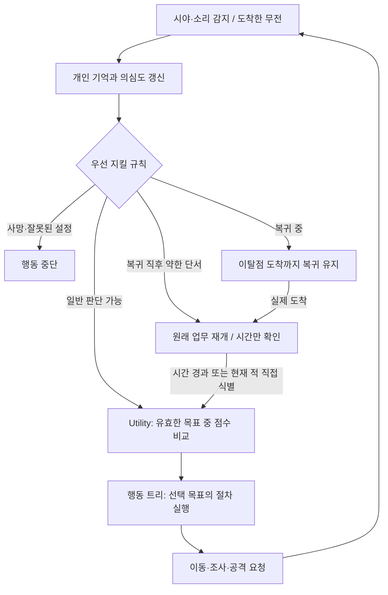

# 적 NPC AI 코드를 처음 읽는 팀원을 위한 안내

2026-11-06 팀 피드백 반영판. 이 AI는 **감지 → 개인 기억 → 꼭 지킬 규칙 → 목표 선택 → 행동 실행** 순서로 움직입니다. 아래 설명은 모델·애니메이션이 없는 도형 NPC에도 적용됩니다. 실제 실행 결과는 [검증 보고서](../Results/Verification.md)에 기록합니다.

## 먼저 세 가지를 구분하세요

| 이름 | 쉬운 설명 | 예 |
|---|---|---|
| 업무 `EnemyDuty` | 사건이 끝난 뒤 돌아가야 할 원래 할 일 | 4번 순찰점으로 이동하던 중 |
| 목표 `EnemyGoal` | 지금 하기로 선택한 일 | 소리 확인, 수색, 공격, 이탈점 복귀 |
| 추적 기록 `Episode` | 업무를 벗어났다가 돌아오는 동안 보관하는 기록 | 출발 위치, 마감 시각, 다음 순찰점 |

`EnemyState`의 Calm/Alert/Search/Combat은 기존 UI에 알려 주는 요약입니다. 실제 목표를 별도의 FSM이 다시 결정하지 않습니다. Calm이어도 순찰인지 복귀인지는 `CurrentGoal`과 `PursuitPhase`를 함께 봅니다.

Utility는 **무엇을 할지 고르는 담당**, 행동 트리는 **선택한 일을 어떤 순서로 끝낼지 수행하는 담당**입니다. 수색을 고르면 조사점 준비 → 이동 → 잠깐 둘러보기 → 다음 지점 → 처리 완료를 수행합니다. 이동 경로는 자체 A*가 찾습니다.

## 파일을 읽는 순서

링크는 실제 코드입니다. `partial`이라고 적힌 세 파일은 긴 `EnemyAgent` 클래스 하나를 역할별로 나눈 것입니다.

| 순서 | 파일 | 먼저 볼 내용 |
|---|---|---|
| 1 | [EnemyTypes.cs](../../../Assets/NullTraceAI/Runtime/EnemyTypes.cs), [EnemyTarget.cs](../../../Assets/NullTraceAI/Runtime/EnemyTarget.cs) | 업무·목표 이름, 플레이어 생존·밝기 |
| 2 | [EnemyProfile.cs](../../../Assets/NullTraceAI/Runtime/EnemyProfile.cs) | 거리·초·점수 등 조절할 수치 |
| 3 | [EnemyAgent.cs](../../../Assets/NullTraceAI/Runtime/EnemyAgent.cs) | `Tick → Step`, 강제 규칙, `BuildCandidates`, 추적·복귀 |
| 4 | [EnemyMemory.cs](../../../Assets/NullTraceAI/Runtime/EnemyMemory.cs), [NoiseBus.cs](../../../Assets/NullTraceAI/Runtime/NoiseBus.cs), [RadioChannel.cs](../../../Assets/NullTraceAI/Runtime/RadioChannel.cs) | 사건별 기억·감쇠, 지연 전달, 중복 방지 |
| 5 | [EnemyBehaviorTree.cs](../../../Assets/NullTraceAI/Runtime/EnemyBehaviorTree.cs), [EnemyAgent.Actions.cs](../../../Assets/NullTraceAI/Runtime/EnemyAgent.Actions.cs) | 점수 비교와 선택 목표의 실행 순서 |
| 6 | [EnemyAgent.Movement.cs](../../../Assets/NullTraceAI/Runtime/EnemyAgent.Movement.cs), [GridWorld2D.cs](../../../Assets/NullTraceAI/Runtime/GridWorld2D.cs) | 경로 요청, 실제 충돌, 도착·막힘 처리 |
| 7 | [MovementConstraint2D.cs](../../../Assets/NullTraceAI/Runtime/Navigation/MovementConstraint2D.cs), [AStarPathfinder.cs](../../../Assets/NullTraceAI/Runtime/Navigation/AStarPathfinder.cs), [GridMap.cs](../../../Assets/NullTraceAI/Runtime/Navigation/GridMap.cs) | 구역·몸체 검사, 지나갈 칸, 자체 A* |
| 8 | [EnemyDialogue.cs](../../../Assets/NullTraceAI/Runtime/EnemyDialogue.cs), [SpeechGate.cs](../../../Assets/NullTraceAI/Runtime/SpeechGate.cs) | 선택적 문장 생성, 기본 대사, 취소·시간 제한·반복 간격 |

`Demo`는 조작과 상태 표시, `Editor/SandboxBuilder.cs`는 예제 씬 생성, `Tests`는 자동 검증입니다. 실제 게임 규칙은 `Runtime`에 있습니다.

## 한 번의 순찰과 추적을 따라가기

1. 3번 지점에 도착하면 다음 방문 번호를 4번으로 바꿉니다. **도착하기 전에 번호를 넘기지 않습니다.** `StartPatrol()` 한 번은 방문 목록 한 회차와 마지막 초소 복귀까지입니다. `AutoStartPatrol`은 초기 회차 시작 편의 기능이며 무한 반복 명령이 아닙니다.
2. 4번으로 가던 중 총성을 들으면 소리 사건을 기억하고 대응 목표를 고릅니다. 처음 대응할 때 현재 위치를 이탈점으로 저장합니다. 3번 지점이나 초소가 자동으로 이탈점이 되는 것은 아닙니다.
3. 확인→수색→교전으로 바뀌어도 같은 추적 기록을 씁니다. 새 총성이 들려도 최초 이탈점과 마감은 바뀌지 않습니다. 기본 예산은 20초, 반경은 8월드 단위입니다.
4. 시간이 끝나거나 처리할 대응 후보가 없으면 이탈점으로 복귀합니다. 새 소리나 보이는 적은 기억에 남기지만 **복귀 중 새 추적을 시작하지 않습니다. 일반 복귀 이동 중 공격도 하지 않지만, 경로가 3회 막혀 정지하면 제자리 방어를 할 수 있습니다.**
5. 실제 도착하면 원래 업무를 복원하고 추적 기록을 끝냅니다. 이어서 4번 지점으로 가며, 약한 단서에만 기본 2초 재조사 대기를 적용합니다. 그 지점이나 초소의 도착을 기다리는 조건은 없습니다.
6. 대기 중이라도 적을 현재 직접 식별하고 있다면 정상적인 공격 조건을 검사해 대응할 수 있습니다. 이미 조사한 옛 소리만으로 같은 추적을 반복하지는 않습니다.

## 발견 정도와 의심도는 다른 숫자입니다

`Detection`은 **지금 보이는 대상을 얼마나 확실히 알아봤는지**를 나타내는 0~1 값입니다. `DetectionGain = 1`이면 계속 보일 때 0.1초에 0.1씩 증가합니다. 현재 시야가 없으면 공격하지 않습니다.

`Suspicion`은 **이 NPC가 받은 단서의 기여를 합친 값**이며 0~100입니다. 기여는 `기본 점수 × 세기 × 신뢰도`이고, 기본 소리 점수는 발소리 15, 문 25, 총성 60(소음권총 30), 장전 20, 비명 50, 깡통·유인탄 30입니다. 직접 들으면 신뢰도 1.0, 무전으로 받으면 0.8이므로 총성을 세기 0.5·신뢰도 1로 들었다면 30점입니다. 소리 외의 단서·시야 이벤트(시체·문 상태·탄피·혈흔·떨어진 무기·무응답·번쩍임·움직임 포착·불 꺼짐·동료 쓰러짐·문 움직임)도 같은 식으로 더하며, 22종 전체 점수·수명은 [DB설계.md](../DB설계.md) 2장입니다. 직접 식별 시각 정보는 90점 이상을 유지하지만 매 프레임 90점을 더하지 않습니다.

소리 세기는 `음량 × 거리 배율 × 벽 배율의 벽 수만큼 곱`입니다. 음량 1, 반경 10, 거리 5, 벽 배율 0.5, 벽 1개라면 `1 × (1−5/10) × 0.5 = 0.25`입니다. 벽 수는 서로 다른 Collider2D 수이므로 합쳐진 충돌체에서는 실제 벽 개수와 다를 수 있습니다.

기본 설정에서 새 유효 정보가 3초 동안 없으면 전체 기여가 초당 6점씩 줄어듭니다. 단서 3개에 각각 6점씩 적용하지 않습니다. 소리는 발생 후 15초, 시각은 관측 후 8초를 기준으로 만료합니다. 무전 수신 시각으로 수명을 늘리지 않습니다.

## 목표를 자꾸 바꾸지 않는 이유

일반 목표는 기본 0.2초마다 비교합니다. 유효한 현재 목표는 최소 0.5초 유지하고, 새 목표가 10점 이상 유리할 때 바꿉니다. 다만 시야 상실·목표 무효·강제 복귀는 유지 시간을 기다리지 않습니다.

의심도 구간은 대사용 긴장도 6단계(평상 0~9·주의 10~29·수색 30~49·적극 수색 50~69·교전 준비 70~89·높은 위협 90~100)와 같습니다. 확인은 의심도 10 이상, 수색은 30 이상에서 후보가 됩니다. 하던 확인은 5 미만, 수색은 25 미만이면 빠집니다. 진입·이탈 기준을 다르게 두어 경계 근처에서 동작이 흔들리는 일을 줄입니다.

공격은 살아 있는 대상을 **현재 직접 식별**하고 사거리·시야·벽·허용 구역을 모두 통과해야 요청합니다. 발사 간격을 기다리는 것은 Attack 안의 동작입니다. 한 발 쐈다는 이유로 목표를 왕복하지 않으며, 목표를 바꿨다 돌아와도 발사 시간을 앞당기지 않습니다. `AttackRequested`는 전투 코드에 보내는 요청이고 피해나 총알 자체가 아닙니다.

## 길찾기가 멈추면 무엇을 볼까요?

이동 구역은 목적별 사각형이며, 추적과 이탈점 복귀는 고정 원과 겹친 부분만 허용합니다. 목적지뿐 아니라 몸체와 이동 구간도 안쪽이어야 합니다. 불가능한 목적지를 경계점으로 바꿔 놓고 도착했다고 하지 않습니다.

A*의 `g`는 이미 걸어온 비용, `h`는 남았을 것으로 예상하는 최소 비용, `f = g + h`는 합계입니다. 작은 f부터 검사합니다. 직선 10·대각선 14는 거리 비율을 나타내는 비용이며 초가 아닙니다. 구역 조건도 탐색 중 후보 간선에 적용해 안쪽 우회로를 찾습니다.

필수 복귀·순찰 이동 실패는 최소 1초 간격으로 최초 포함 3회 확인합니다. 계속 막히면 제자리 경계·보고와 허용된 방어를 하며 맵 변경 또는 기본 5초 간격으로 재확인합니다. 문을 바꾼 코드는 `World.Rebuild()`로 격자 변경을 알려 줍니다. `PathError`는 원인, `PathRequestCount`는 요청 횟수, `PursuitPhase.ReturnBlocked`는 추적 복귀가 막힌 상태입니다.

## 팀 기능을 붙이는 위치

- 플레이어 로직 루트에 `EnemyTarget`을 붙이고 `IsAlive`와 `Light`를 갱신합니다. 조도는 팀 조명·은신 코드가 제공하며 화면 픽셀을 자동 분석하지 않습니다.
- 발소리·문·총성·장전·비명·깡통·유인탄은 실제 발생할 때 `NoiseBus.Publish`로 알립니다. 같은 사건을 전달하면서 새 ID를 만들지 않습니다.
- 같은 무전망 NPC는 같은 `RadioChannel`을 참조합니다. 기본 지연은 0.5초이며 받기 전에는 상대의 지식을 쓸 수 없습니다.
- 외형은 로직 루트의 `Visual` 자식에 연결합니다. `StateChanged`, `SpeechRequested`, `AttackRequested`를 구독해 애니메이션·말풍선·전투와 잇고, 비활성화 때 해제합니다.
- `EnemyDialogue`가 없어도 기본 대사가 동작합니다. Qwen은 `IEnemyDialogueProvider`를 구현한 비동기 생성기로 연결합니다. 제공자는 같은 PC의 `llama-server`(`127.0.0.1`)에 상황 상태값을 보내고 `{"line":"…","emotion":"…"}`(20자 이내 한 줄, 감정 5종)를 돌려받습니다. 길이·한국어·정보 누출·금지어·반복·상황 일치 검사를 통과하지 못하면 기본 대사를 씁니다([DB설계.md](../DB설계.md) 4·5장). 모델은 문장만 만들며 목표·경로·공격·기억·의심도를 결정하지 않습니다.

자동 `Update`와 수동 `Tick` 중 한 방식으로 시간을 진행합니다. 둘을 같이 쓰면 시간이 두 번 흐릅니다. 수동 테스트에서는 `PublishAt`에 같은 기준의 `GameTime`을 줍니다. 대사 생성의 2초 제한만 실제 시간을 쓰며 일시정지 중에는 출력하지 않습니다.

연결 예는 [Integration.md](Integration.md), 공개 약속은 [IntegrationContract.md](IntegrationContract.md), 세부 구현은 [AI.md](AI.md)와 [Navigation.md](Navigation.md)를 참고하세요.

## 이번에 줄이거나 제한한 것

EnemyMemory는 유효 단서 최대 8개와 제거 이력 최대 32개만 기억합니다. 복잡한 간접 신뢰도 병합은 없앴지만 원본 시각·만료·중복 방지는 유지합니다. AiDoor2D는 일반문/잠금문을 구분하고, PathRequestBudget은 한 프레임의 경로 계산을 기본 4개로 나눕니다. 대기 중이라는 이유만으로 길찾기 실패 횟수를 늘리지 않습니다. 무전 큐와 전체 대사 생성도 상한을 둡니다(대사 생성은 전체 동시 1건·대기열 4건). 연결 순서·수치·인수 확인은 [인수인계 문서](적_NPC_AI_인수인계_및_사양확인_2026-11-06.md)를 먼저 읽으세요.
